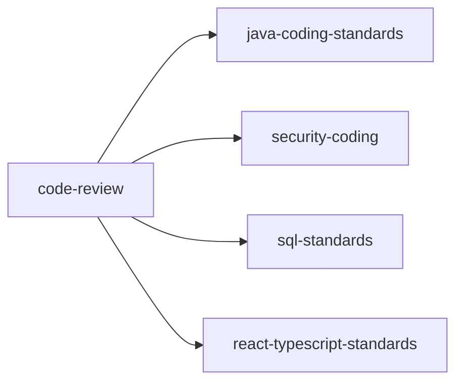
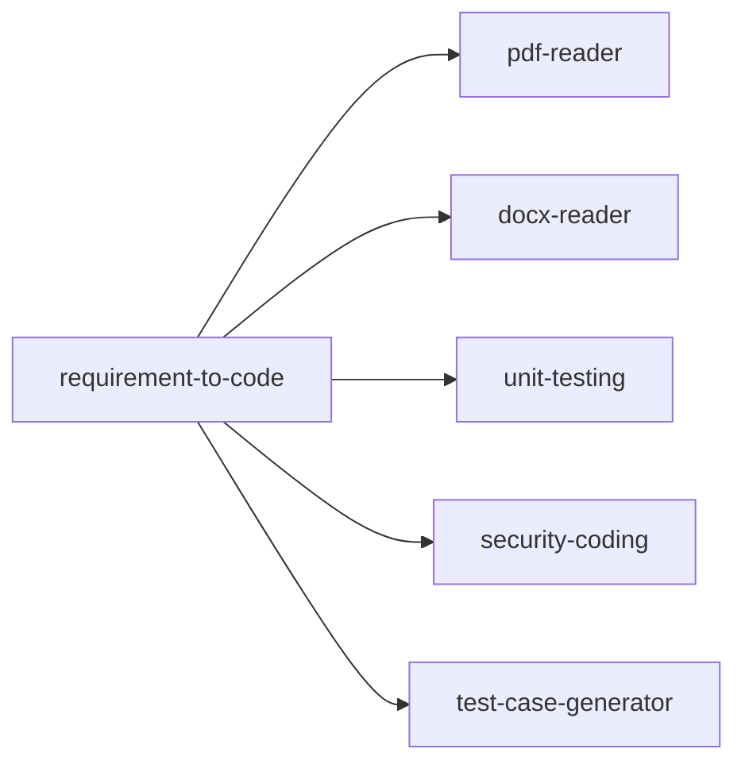

# 🤖 AI Skills 技能仓库

> **一个结构化的 Agent 技能集合**  
> 为 Agent 提供专业化的开发规范、工具集成和工作流指导

---

## 📚 仓库概述

本仓库包含了一系列专门为 AI Agent 设计的 **Skills**（技能），每个 Skill 都是一个 Markdown 文件，定义了 AI 在特定场景下的行为准则、最佳实践和工作流程。

### ✨ 核心特性

- **模块化设计**：每个 Skill 独立维护，职责单一
- **场景化触发**：根据用户输入自动激活相关 Skill
- **标准化格式**：统一的 frontmatter 元数据和文档结构
- **可组合性**：Skill 之间可以互相调用和联动
- **语言适配**：支持 Java、Python、Go、TypeScript 等多语言规范

---

## 🎯 Skill 分类

### 🔧 编码标准类 (Coding Standards)

| Skill | 版本 | 描述 | 触发场景 |
|-------|------|------|----------|
| **[java-coding-standards](java-coding-standards/)** | 1.0.0 | Spring Boot 服务的 Java 编码标准 | 编写 Java 代码、代码审查时 |
| **[python-standards](python-standards/)** | 1.0.0 | Python 3.10+ 编码规范 | 编写 Python 代码时 |
| **[golang-standards](golang-standards/)** | 1.0.0 | Go 1.21+ 编码规范 | 编写 Go 代码时 |
| **[react-typescript-standards](react-typescript-standards/)** | 1.0.0 | React + TypeScript 前端规范 | 编写前端代码时 |
| **[sql-standards](sql-standards/)** | 1.0.0 | SQL 编写规范 | 编写 SQL 语句时 |

### 🛡️ 安全与质量类 (Security & Quality)

| Skill | 版本 | 描述 | 触发场景 |
|-------|------|------|----------|
| **[security-coding](security-coding/)** | 1.0.0 | OWASP Top 10 安全编码规范 | 编写安全相关代码时 |
| **[code-review](code-review/)** | 2.0.0 | Code Review 全流程指南 | PR Review、代码审查时 |
| **[unit-testing](unit-testing/)** | 2.0.0 | 单元测试最佳实践 | 编写单元测试时 |

### 🔄 开发工作流类 (Development Workflow)

| Skill | 版本 | 描述 | 触发场景 |
|-------|------|------|----------|
| **[requirement-to-code](requirement-to-code/)** | 2.3.0 | 从需求到代码的全流程工程实践 | 需求开发、自动开发时 |
| **[test-case-generator](test-case-generator/)** | 5.6.0 | 自动生成测试用例和测试报告 | 生成测试用例、创建测试时 |
| **[git-standards](git-standards/)** | 1.0.0 | Git 工作规范和协作流程 | Git 操作、提交代码时 |
| **[create-skill](create-skill/)** | 2.0.0 | 交互式创建新 Skill 的向导 | 创建新 Skill 时 |

### 📐 设计与架构类 (Design & Architecture)

| Skill | 版本 | 描述 | 触发场景 |
|-------|------|------|----------|
| **[api-design](api-design/)** | 1.0.0 | RESTful API 设计规范 | 设计 API 接口时 |

### 🐳 基础设施类 (Infrastructure)

| Skill | 版本 | 描述 | 触发场景 |
|-------|------|------|----------|
| **[docker-standards](docker-standards/)** | 1.0.0 | Docker 镜像构建最佳实践 | 编写 Dockerfile 时 |
| **[redis-standards](redis-standards/)** | 1.0.0 | Redis 缓存使用规范 | 使用 Redis 时 |

### 📄 文档解析类 (Document Parsing)

| Skill | 版本 | 描述 | 触发场景 |
|-------|------|------|----------|
| **[pdf-reader](pdf-reader/)** | 1.0.0 | PDF 文档文本和表格提取 | 读取 PDF 文件时 |
| **[docx-reader](docx-reader/)** | 1.0.0 | Word 文档文本和表格提取 | 读取 Word 文件时 |

---

## 📊 统计信息

- **总 Skill 数量**：17 个
- **覆盖语言**：Java, Python, Go, TypeScript, SQL
- **最新版本**：test-case-generator v5.6.0
- **作者**：Yanghaiji

---

## 🚀 快速开始

### 如何使用 Skill

每个 Skill 都定义了**触发条件**，当用户输入匹配这些条件时，AI Agent 会自动激活对应的 Skill。

#### 示例 1: Java 开发

```text
用户："帮我写一个 Spring Boot 的用户服务"
→ 自动激活：java-coding-standards Skill
→ 遵循 Java 编码规范生成代码
```

#### 示例 2: 代码审查

```text
用户："审查这个 PR"
→ 自动激活：code-review Skill
→ 按五大维度（正确性、安全性、性能、可维护性、规范性）进行审查
```

#### 示例 3: 需求转代码

```text
用户："根据这个需求文档实现功能" + [需求文档路径]
→ 自动激活：requirement-to-code Skill
→ 执行 Phase 1(需求分析) → Phase 2(技术方案) → Phase 3(TDD 开发)
```

### 手动激活 Skill

如果自动触发未生效，可以直接提及 Skill 名称：

```text
"按照 security-coding 规范检查这段代码"
"用 api-design 规范设计这个接口"
"参考 test-case-generator 生成测试用例"
```

---

## 🔗 Skill 联动

部分 Skill 可以互相调用，形成完整的工作流：

### Code Review 联动链



### Requirement to Code 联动链



---

## 📁 目录结构

```
Skills\
├── api-design/                    # RESTful API 设计规范
│   ├── SKILL.md                   # 主技能文件
│   └── references/                # 参考资料
│
├── code-review/                   # Code Review 指南
│   ├── SKILL.md
│   └── references/
│       ├── detailed-checklist.md
│       └── output-format.md
│
├── create-skill/                  # 创建 Skill 向导
│   ├── SKILL.md
│   ├── assets/                    # 模板资源
│   └── references/
│
├── docker-standards/              # Docker 规范
│   └── SKILL.md
│
├── docx-reader/                   # Word 文档解析
│   ├── SKILL.md
│   └── scripts/                   # Python 脚本
│       ├── extract_all.py
│       ├── extract_tables.py
│       └── extract_text.py
│
├── git-standards/                 # Git 规范
│   └── SKILL.md
│
├── golang-standards/              # Go 语言规范
│   └── SKILL.md
│
├── java-coding-standards/         # Java 语言规范
│   ├── SKILL.md
│   ├── README.md
│   └── references/
│
├── pdf-reader/                    # PDF 文档解析
│   ├── docs/                      # PDF 文档
│   │   └── Java 开发手册.pdf
│   ├── SKILL.md
│   └── scripts/
│       ├── extract_all.py
│       ├── extract_tables.py
│       └── extract_text.py
│
├── python-standards/              # Python 语言规范
│   ├── SKILL.md
│   └── README.md
│
├── react-typescript-standards/    # 前端规范
│   ├── SKILL.md
│   └── references/
│
├── redis-standards/               # Redis 规范
│   └── SKILL.md
│
├── requirement-to-code/           # 需求转代码全流程
│   ├── SKILL.md                   # v2.3 最新版
│   ├── SKILL_v2.0_full_backup.md  # 备份版本
│   ├── README.md
│   └── references/
│       ├── code_styles.md
│       ├── patterns.md
│       └── requirements-clarity.md
│
├── security-coding/               # 安全编码规范
│   └── SKILL.md
│
├── sql-standards/                 # SQL 规范
│   ├── SKILL.md
│   └── README.md
│
├── test-case-generator/           # 测试用例生成器
│   ├── SKILL.md
│   ├── main.py                    # 主程序入口
│   ├── README.md
│   ├── scripts/                   # 内部脚本
│   ├── templates/                 # 输出模板
│   └── references/
│
└── unit-testing/                  # 单元测试规范
    ├── SKILL.md
    └── references/
        └── examples.md
```

---

## 🛠️ 技术栈依赖

### Python 脚本依赖

部分 Skill 包含 Python 脚本，需要安装以下依赖：

```bash
# PDF 解析
pip install pdfplumber

# Word 文档解析
pip install python-docx

# OCR（可选，用于图片型 PDF）
# 需单独安装 Tesseract OCR 引擎
```

### 其他工具

- **Git**: 版本控制和分支管理
- **Docker**: 容器化部署
- **Python 3.10+**: 脚本运行环境

---

## 📝 Skill 编写规范

每个 Skill 文件遵循统一的结构：

### Frontmatter 元数据

```yaml
---
name: skill-name
description: "一句话描述技能用途和触发条件"
metadata:
  author: Yanghaiji
  version: "1.0.0"
---
```

### 文档结构

1. **何时激活** - 触发条件说明
2. **核心原则** - 设计理念
3. **详细规范** - 具体规则（含代码示例）
4. **最佳实践** - 实战建议
5. **参考资料** - 引用相关文件

---

## 🎓 学习路径

### 初学者

1. 了解基本概念 → 阅读 [create-skill](create-skill/)
2. 掌握文档解析 → 学习 [pdf-reader](pdf-reader/)、[docx-reader](docx-reader/)
3. 熟悉编码规范 → 选择你的主要语言：
   - Java → [java-coding-standards](java-coding-standards/)
   - Python → [python-standards](python-standards/)
   - Go → [golang-standards](golang-standards/)
   - 前端 → [react-typescripts-standards](react-typescript-standards/)

### 进阶者

1. 学习完整工作流 → [requirement-to-code](requirement-to-code/)
2. 掌握测试策略 → [test-case-generator](test-case-generator/) + [unit-testing](unit-testing/)
3. 提升代码质量 → [code-review](code-review/) + [security-coding](security-coding/)

### 专家级

1. 设计 API 架构 → [api-design](api-design/)
2. 容器化部署 → [docker-standards](docker-standards/)
3. 性能优化 → [redis-standards](redis-standards/)
4. 团队协作 → [git-standards](git-standards/)

---

## 🔄 版本历史

### requirement-to-code

- **v2.3.0** (当前): 增强灵活性，支持自适应 DDD 建模深度、场景化开发顺序调整
- **v2.0.0**: 完整的 4 阶段流程（PM → 架构师 → 开发 → QA）
- **v1.x**: 早期版本

### test-case-generator

- **v5.6.0** (当前): Git 仓库集成、图片型 PDF 支持、统一 Python 测试
- **v5.x**: 多格式输出、XMind 思维导图
- **v4.x**: Excel 导出、HTML 报告

---

## 🤝 贡献指南

### 如何创建新 Skill

1. 使用 `create-skill` Skill 交互式创建
2. 遵循 SKILL.md 模板结构
3. 明确定义触发条件
4. 提供详细的代码示例
5. 添加参考资料到 `references/` 目录

### 如何改进现有 Skill

1. Fork 本仓库
2. 修改对应的 `SKILL.md` 文件
3. 更新版本号
4. 提交 Pull Request

---

## 📞 联系方式

- **作者**: Yanghaiji
- **版本**: 2026.09

---

## 📜 许可证

MIT License

---

## 💡 提示

> **记住**: 每个 Skill 都在其 `SKILL.md` 文件中定义了**何时激活**。当你不确定是否应该使用某个 Skill 时，查看该文件的"何时激活"章节即可。

> **最佳实践**: 多个 Skill 可以同时激活，例如在进行 Code Review 时，`code-review` 会自动联动 `java-coding-standards`、`security-coding` 等多个 Skill。

---

*Last Updated: September 18, 2026*
