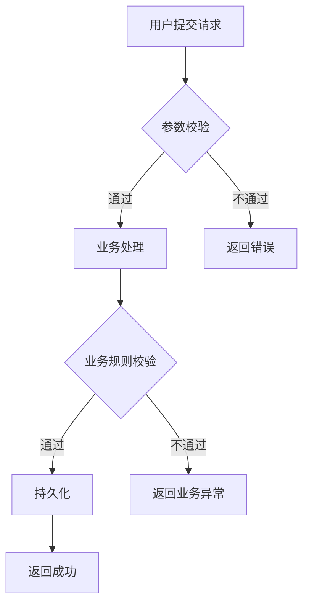

# Requirement to Code v2.3

> 以资深产品经理的思维梳理需求，以资深架构师的视角设计方案，以 TDD 的方式交付代码。

## 角色

- **Phase 1-2**：资深产品经理 → 需求分析 → 输出 PRD
- **Phase 2-3**：资深架构师 → DDD 领域建模 → 技术方案 → TDD 编码

## 流程总览

```
Phase 1 [PM]      Phase 2 [Architect]    Phase 3 [Developer]   Phase 4 [QA]
需求分析 → PRD ──→ 技术方案设计 ──→ TDD开发 ──→ 代码审查
              ↕                  ↕                ↕
          用户确认            用户确认         逐模块确认
```

**铁律**：每个 Phase 完成后需要用户确认，但小幅度调整（≤3 处细节修改）可在下一环节自动修正，无需单独确认。

---

## Phase 1: 需求分析（PM）

### 1.1 收集输入

- **必须**：需求文档路径（.pdf / .md / .txt / .docx）
- **按需**：仓库路径、分支名（若已在 IDE 中打开项目则免）

**需求清晰度评估**：
- 如果需求模糊（功能描述不清、缺少验收标准、无技术约束），先使用 `requirements-clarity` Skill 进行澄清，直到清晰度 ≥ 90 分
- 文档读取：`.md/.txt` 用 Read，`.pdf` 用 pdf-reader Skill，`.docx` 用 docx-reader Skill。

### 1.2 需求分析产出

以资深 PM 视角分析需求，在对话中直接输出 PRD，包含：

#### A. 需求概览
- 背景、核心目标、目标用户、成功指标

#### B. 用户故事
每个功能点用 `作为 [角色]，我希望 [功能]，以便 [价值]` 格式，附 Given/When/Then 验收标准：

```
作为 [注册用户]，我希望 [通过手机号验证码登录]，以便 [快速安全地访问系统]。

验收标准：
- Given 已注册账号，When 输入正确手机号和验证码，Then 登录成功并跳转首页
- Given 无效验证码，When 尝试登录，Then 提示"验证码错误或缺失"
```

#### C. 功能模块清单
表格形式，含模块名、描述、优先级 (P0/P1/P2)、复杂度、依赖、验收标准：

| 模块名 | 描述 | 优先级 | 复杂度 | 依赖 | 验收标准 |
|--------|------|--------|--------|------|----------|
| 用户登录 | 支持手机号验证码登录 | P0 | 中等 | 短信服务 | 1. 发送验证码成功<br>2. 验证通过可登录 |

#### D. 边界条件与异常场景
对每个功能点的分析：Happy Path、边界条件（空值/极值/并发）、异常场景（网络/权限/超时）、业务规则约束

#### E. 业务流程图
复杂流程用 Mermaid 语法，覆盖主流程 + 异常分支 + 状态流转：



#### F. 非功能性需求
性能（响应时间、吞吐量）、安全（OWASP Top 10）、兼容性（浏览器/设备版本）

执行需求分析可以参考：`references/requirements-clarity.md`

### 1.3 确认门控

用 AskUserQuestion 确认 PRD：「确认，进入技术方案」/「需要调整」。修改后重新确认。

---

## Phase 2: 技术方案设计（架构师）

### 2.1 项目上下文分析

**写任何设计之前**，先理解项目现有架构：

1. 读 `pom.xml`/`package.json`/`build.gradle` 确认技术栈
2. 用 Glob 扫描目录结构，用 SearchMemory 检索项目知识
3. 识别分层架构模式、设计模式、模块间依赖
4. 只读与需求相关的模块（禁止全量扫描），分析命名/注释/异常处理/日志等代码风格

**自适应策略**：
- **新项目**（< 3 个月）：快速原型模式，先出 MVP 方案，边开发边完善
- **成熟项目**（≥ 6 个月）：严格遵循现有架构，充分评估影响范围
- **遗留系统**：增量改造原则，优先封装适配层，避免直接修改核心代码

### 2.2 DDD 领域建模

根据需求复杂度进行**自适应深度**的 DDD 建模：

**需求复杂度评估矩阵**：
| 复杂度 | 特征 | DDD 深度 | 建议 |
|--------|------|----------|------|
| **L1 简单** | ≤3 功能点，无复杂规则 | 轻量级 | 只定义核心实体 + 聚合根 |
| **L2 中等** | 4-8 功能点，有业务规则 | 标准级 | 完整战术设计（实体/值对象/聚合/事件） |
| **L3 复杂** | >8 功能点，多系统交互 | 完整级 | 战略 + 战术设计，含限界上下文映射 |

**快速判断示例**：
```
# L1 简单需求示例：添加"导出 Excel"功能
# → 只需定义 OrderEntity + OrderRepository 接口

# L2 中等需求示例：实现"订单退款流程"
# → 需要完整的 Order 聚合 + RefundEvent + RefundService

# L3 复杂需求示例：构建"智能推荐系统"
# → 需要多个限界上下文（用户上下文、商品上下文、推荐上下文）+ 上下文映射
```

**战略设计**：
- 领域划分：核心域 / 支撑域 / 通用域
- 限界上下文：职责边界、上下文关系、上下文映射图

**战术设计**（对每个限界上下文）：

**实体定义示例**：
```
实体名：OrderEntity
唯一标识：id: Long
属性:
  - orderId: String       // 订单号
  - status: OrderStatus   // 订单状态
  - totalAmount: Decimal  // 总金额
生命周期：创建 → 支付 → 发货 → 完成/取消
```

**值对象定义示例**：
```
值对象：MoneyVO
属性:
  - amount: Decimal       // 金额
  - currency: String      // 币种 (默认 CNY)
不变量：amount 不能为负数
```

**聚合定义示例**：
```
聚合根：OrderAggregateRoot
包含实体：[OrderEntity, OrderItemEntity]
包含值对象：[MoneyVO, AddressVO]
不变量:
  - 订单状态为已取消时不能修改
  - 总金额 = 所有订单项金额之和
```

**领域事件定义示例**：
```
事件名：OrderCreatedEvent
触发时机：订单创建成功时
携带数据：[orderId, userId, totalAmount]
消费者：[库存服务、积分服务、通知服务]
```

**仓储接口定义示例**：
```
仓储名：OrderRepository
方法:
  - findById(id): OrderEntity
  - save(entity): void
  - findByUserId(userId): List<OrderEntity>
  - checkStock(orderId): Boolean
```

**领域服务**：不适合放在实体中的业务逻辑

> **提示**：如果不确定复杂度等级，采用**渐进式策略**：先按 L2 标准设计，开发中根据反馈调整。

### 2.3 分层架构设计

基于项目现有分层，设计各层职责和新增/修改的文件清单。原则：与项目现有结构保持一致。

**典型分层结构**：
```
┌─────────────────────────────┐
│   接口层 (Controller/Adapter) │
├─────────────────────────────┤
│   应用层 (Application Service)│
├─────────────────────────────┤
│   领域层 (Domain Entity/Service)│
├─────────────────────────────┤
│   基础设施层 (Repository/Mapper)│
└─────────────────────────────┘
```

### 2.4 API 接口设计

每个接口定义：HTTP 方法、路径、请求参数（含校验规则）、响应结构、异常场景（400/404/409 等）。

**API 设计模板示例**：
```
接口名称：创建订单
HTTP 方法：POST
路径：/api/v1/orders

请求参数:
  - productId: Long (required)     // 产品 ID，不能为空
  - quantity: Integer (required)   // 数量，1-999
  - userId: Long (required)        // 用户 ID

响应结构:
  {
    "code": 200,
    "message": "success",
    "data": {
      "orderId": "ORD20260918001",
      "totalAmount": 99.99,
      "status": "CREATED"
    }
  }

异常场景:
  - 400: 参数校验失败（quantity < 1 或 > 999）
  - 404: 产品不存在或用户不存在
  - 409: 库存不足
  - 500: 系统内部错误
```

### 2.5 数据模型设计

新建/修改的表：DDL 语句，审计字段和命名规范与项目现有表保持一致。

**建表语句模板示例**：
```sql
-- 表名：t_order
-- 说明：订单表
CREATE TABLE t_order (
    id          BIGINT       PRIMARY KEY AUTO_INCREMENT COMMENT '主键 ID',
    order_id    VARCHAR(64)  NOT NULL UNIQUE COMMENT '订单号',
    user_id     BIGINT       NOT NULL COMMENT '用户 ID',
    product_id  BIGINT       NOT NULL COMMENT '产品 ID',
    quantity    INT          NOT NULL DEFAULT 1 COMMENT '数量',
    total_amount DECIMAL(12,2) NOT NULL COMMENT '总金额',
    status      VARCHAR(20)  NOT NULL DEFAULT 'CREATED' COMMENT '订单状态',
    
    -- 审计字段（与项目规范一致）
    create_time DATETIME     NOT NULL DEFAULT CURRENT_TIMESTAMP COMMENT '创建时间',
    update_time DATETIME     NOT NULL DEFAULT CURRENT_TIMESTAMP ON UPDATE CURRENT_TIMESTAMP COMMENT '更新时间',
    create_by   VARCHAR(64)  DEFAULT NULL COMMENT '创建人',
    update_by   VARCHAR(64)  DEFAULT NULL COMMENT '更新人',
    is_deleted  TINYINT(1)   NOT NULL DEFAULT 0 COMMENT '逻辑删除: 0-未删除，1-已删除'
) COMMENT '订单表';

-- 索引建议
CREATE INDEX idx_order_user ON t_order(user_id);
CREATE INDEX idx_order_status ON t_order(status);
```

> **原则**：审计字段、命名规范、索引策略必须与项目现有表结构保持一致。

### 2.6 测试策略

定义测试分层（单元/集成/接口），每层明确：测试框架、覆盖范围、需 Mock 的依赖。

### 2.7 输出技术方案

在对话中输出技术方案文档，包含：项目上下文 → DDD 领域模型 → 分层架构 → API 设计 → 数据模型 → 测试策略 → 开发任务拆解（按 DDD 分层排序）→ 风险与决策。

### 2.8 确认门控

用 AskUserQuestion 确认方案：「确认，开始 TDD 开发」/「需要调整」。

---

## Phase 3: TDD 开发

### 3.1 TDD 循环

每个开发任务严格遵循：**RED**（写失败测试）→ **GREEN**（最少代码通过）→ **REFACTOR**（重构保持通过）。

### 3.2 开发顺序（DDD 分层驱动）

**推荐顺序**（确保依赖关系正确）：

```
Step 1: 领域层（Domain Layer）
  ├── 1.1 实体和值对象（Entity & Value Object）
  ├── 1.2 聚合根（Aggregate Root）
  ├── 1.3 领域事件（Domain Event）
  ├── 1.4 仓储接口（Repository Interface）
  └── 1.5 领域服务（Domain Service）
  → 单元测试（无需 Mock 框架）

Step 2: 应用层（Application Layer）
  ├── 2.1 应用服务（Application Service）
  ├── 2.2 DTO Converter / Assembler
  └── 2.3 Command/Query Handler
  → 单元测试（Mock 仓储和外部依赖）

Step 3: 接口层（Adapter/Interface Layer）
  ├── 3.1 Controller / API Endpoint
  ├── 3.2 请求/响应 DTO
  └── 3.3 参数校验器（Validator）
  → 接口测试（测试正常响应、参数校验、4xx 异常）

Step 4: 基础设施层（Infrastructure Layer）
  ├── 4.1 仓储实现（Repository Implementation）
  ├── 4.2 Mapper / ORM 配置
  ├── 4.3 外部服务适配器
  └── 4.4 数据库迁移脚本（DDL/DML）
  → 集成测试
```

**灵活调整场景**：
- **快速验证场景**：可先开发接口层 + 模拟数据，验证 UI/UX 后再实现领域逻辑
- **数据迁移场景**：可先实现基础设施层的 DDL 和 Migration 脚本
- **第三方集成场景**：可先开发 Adapter 层，Mock 外部服务后再实现内部逻辑
- **重构场景**：可按"测试 → 新实现 → 老代码废弃"的反向顺序

> **原则**：保持依赖方向正确（外层依赖内层），其他顺序可根据实际情况调整。

### 3.3 编码规范

**铁律：生成的代码必须像项目原有开发者写的。**

- 命名/缩进/注释/异常处理/日志/DTO 模式：全部与项目现有代码保持一致
- 复用优先：优先使用项目已有的工具类、常量、枚举
- 单一职责、最小修改、保持兼容、无硬编码、防御性编程

**代码质量要求**：
- 无魔法数字：提取为常量
- 参数校验：对所有入参做非空和边界检查
- 异常处理：使用项目统一的异常体系和错误码
- 日志规范：记录关键业务节点和异常信息

> **参考**：Java 项目参考 `java-coding-standards` Skill，前端项目参考 `react-typescript-standards` Skill

### 3.4 测试规范

**测试命名规范**：采用 `should_[预期行为]_when_[条件]` 格式，如：
```java
should_create_order_successfully_when_stock_available()
should_reject_order_when_quantity_exceeds_limit()
should_throw_exception_when_user_not_found()
```

**领域层测试**：测试实体行为、值对象相等性、领域服务逻辑（无需 Mock）

**应用层测试**：Mock 仓储和外部依赖，测试编排逻辑和事务边界

**接口层测试**：测试正常响应、参数校验、异常场景（4xx）

**测试覆盖率要求**：
- 领域层核心逻辑：≥ 80%
- 应用层编排逻辑：≥ 70%
- 接口层：100% 覆盖主要路径

> **参考**：单元测试规范参考 `unit-testing` Skill

### 3.5 逐模块确认

每完成一个模块，汇报创建/修改的文件和测试执行情况，确认后继续。

**确认策略**：
- **重大变更**（新增核心领域模型、修改已有 API）→ 必须等待明确确认
- **小幅调整**（参数微调、增加辅助类）→ 可自动修正并在下次汇报时说明
- **紧急修复**（阻塞性 Bug）→ 先修复后汇报，无需等待确认

使用 AskUserQuestion 工具：
- 选项 1：「继续下一个模块」
- 选项 2：「需要调整当前模块」
- 选项 3：「跳过确认，直接继续」（适用于熟悉的小功能）

> **提示**：对于简单需求（L1 级别），可采用"批量确认"方式，每 2-3 个模块汇总一次确认。

---

## Phase 4: 代码审查与收尾

### 4.1 审查清单

所有测试通过 / 代码风格一致 / 无硬编码 / 异常处理完整 / 无遗留 TODO / 日志规范 / API 与方案一致 / DDD 分层正确

**安全检查**：
- [ ] 输入参数已校验（防 SQL 注入、XSS）
- [ ] 敏感数据已加密（密码、身份证号、银行卡）
- [ ] 权限校验已实现（RBAC/ABAC）
- [ ] 无硬编码密钥或凭证
- [ ] 遵循 OWASP Top 10 安全规范

> **参考**：安全编码规范参考 `security-coding` Skill

### 4.2 变更摘要

输出：新增文件列表（含所属层）、修改文件列表（含修改内容）、测试文件列表、数据库变更。

---

## 关键原则

- **工具**：优先使用 AI 原生工具（Read/Write/SearchCodebase/SearchSymbol/Glob/Grep），复杂自动化可用脚本辅助
- **范围**：只读需求相关代码，先理解全貌再深入模块，用 SearchMemory 检索项目知识
- **DDD**：领域模型为核心，领域层不依赖框架，依赖方向 外层→内层；根据复杂度自适应调整建模深度（L1/L2/L3）
- **TDD**：先测试后实现，测试是行为规格，每个测试验证一个行为，覆盖率≥70%
- **门控**：PRD → 技术方案 → 逐模块 → 最终审查，每步需要确认；小幅调整可自动修正，重大变更需明确确认
- **渐进**：支持增量交付，可根据项目阶段选择 MVP 快速迭代或完整方案设计
- **安全**：遵循 OWASP Top 10，输入校验、权限控制、数据保护
- **灵活**：开发顺序可根据场景调整（快速验证/数据迁移/第三方集成），保持依赖方向正确即可

## 快捷入口

- **有 PRD** → 跳过 Phase 1，从 Phase 2 开始
- **有技术方案** → 跳过 Phase 1-2，从 Phase 3 开始（仍需分析项目上下文）
- **口头需求** → Phase 1 通过对话收集，用 AskUserQuestion 逐步澄清；如需求模糊先调用 `requirements-clarity` Skill
- **已有测试用例** → Phase 3 直接使用现有测试用例作为规格依据

---

*先梳理需求，再设计方案，最后写代码。每一步都有确认，每一行代码都有测试。*
