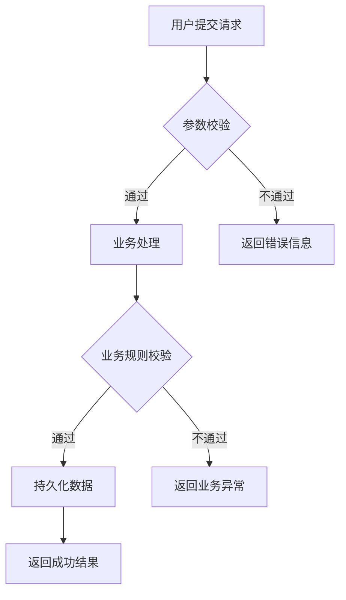

# Requirement to Code v2.0

> **核心理念**：以资深产品经理的思维梳理需求，以资深架构师的视角设计方案，以TDD的方式交付代码。

## 角色定义

本 Skill 在流程中扮演两个核心角色，并在不同阶段切换：

### 角色一：资深产品经理（PM）
- **职责**：需求分析、PRD 编写、用户故事拆分、验收标准定义
- **思维方式**：用户价值优先、边界条件穷举、异常场景覆盖
- **产出物**：结构化 PRD 文档

### 角色二：资深架构师（Architect）
- **职责**：技术选型、DDD 领域建模、API 设计、数据模型设计、测试策略
- **思维方式**：DDD 驱动、关注点分离、可测试性、可扩展性
- **产出物**：技术方案文档 + 测试策略 + 代码

---

## 工作流程总览

```
Phase 1 [PM]        Phase 2 [Architect]      Phase 3 [Developer]     Phase 4 [QA]
需求分析 ──→ PRD ──→ 技术方案设计 ──→ TDD开发 ──→ 代码审查
             ↕                    ↕                  ↕
         用户确认              用户确认           逐模块确认
```

> **铁律**：每个 Phase 完成后**必须**获得用户确认才能进入下一阶段。

---

## Phase 1: 需求分析（PM 角色）

### 1.1 收集输入

向用户收集以下信息（使用 AskUserQuestion 工具）：

**必须收集**：
- 需求文档路径（支持 .pdf / .md / .txt / .docx）

**按需收集**（如果用户未提供当前工作区，则需追问）：
- 代码仓库位置（本地路径）
- 开发分支名称

> **提示**：如果用户已在 IDE 中打开了项目，可直接使用当前工作区，无需追问仓库信息。

### 1.2 读取需求文档

使用 AI 原生工具读取需求文档：
- `.md` / `.txt` 文件：直接使用 `Read` 工具
- `.pdf` 文件：使用 `pdf-reader` Skill
- `.docx` 文件：使用 `docx-reader` Skill

### 1.3 需求深度分析

以资深 PM 的视角对需求进行深度分析，产出以下内容：

#### A. 需求概览
- **需求背景**：为什么要做这个需求？解决什么业务问题？
- **核心目标**：用一句话概括这个需求的核心价值
- **目标用户**：谁会使用这个功能？
- **成功指标**：怎么衡量这个需求做成功了？

#### B. 用户故事（User Stories）

对每个功能点，使用标准用户故事格式：

```
作为 [角色]，我希望 [功能]，以便 [价值]。

验收标准（Acceptance Criteria）：
- Given [前置条件]，When [操作]，Then [预期结果]
- Given [前置条件]，When [操作]，Then [预期结果]
```

#### C. 功能模块拆解

| 维度 | 说明 |
|------|------|
| 模块名称 | 简洁明了的功能名 |
| 功能描述 | 一句话说明做什么 |
| 优先级 | P0（必须实现）/ P1（应该实现）/ P2（锦上添花） |
| 复杂度 | 简单 / 中等 / 复杂 |
| 依赖关系 | 依赖哪些其他模块 |
| 验收标准 | 可测试的验收条件列表 |

#### D. 边界条件与异常场景

对每个功能点，必须分析：
- **正常流程**（Happy Path）
- **边界条件**：空值、最大值、最小值、特殊字符、并发等
- **异常场景**：网络异常、数据不存在、权限不足、超时等
- **业务规则约束**：互斥条件、前置依赖、状态约束等

#### E. 业务流程图

对复杂业务流程，使用 Mermaid 生成流程图：



流程图必须覆盖：
- 主流程（Happy Path）
- 异常分支
- 条件判断节点
- 状态流转（如果有）

### 1.4 输出 PRD 文档

将以上分析整理为结构化的 PRD 文档，直接在对话中呈现给用户（不需要写文件），格式如下：

```markdown
# PRD: [需求名称]

## 1. 需求概览
### 1.1 需求背景
### 1.2 核心目标
### 1.3 目标用户

## 2. 用户故事
### 2.1 [功能模块1]
- 用户故事
- 验收标准

### 2.2 [功能模块2]
...

## 3. 功能模块清单
（表格形式）

## 4. 边界条件与异常场景
### 4.1 [功能模块1]
### 4.2 [功能模块2]

## 5. 业务流程图
（Mermaid 流程图）

## 6. 非功能性需求
- 性能要求
- 安全要求
- 兼容性要求
```

### 1.5 用户确认（门控）

**必须等待用户确认 PRD 后才能进入 Phase 2。**

使用 AskUserQuestion 工具：
- 选项1：「确认 PRD，进入技术方案设计」
- 选项2：「需要调整」（让用户说明修改点，修改后再次确认）

---

## Phase 2: 技术方案设计（架构师角色）

### 2.1 项目上下文分析

**在写任何设计之前**，必须先深入理解项目现有架构。使用以下工具：

1. **项目结构分析**：
   - 使用 `Read` 读取项目根目录的 `pom.xml` / `package.json` / `build.gradle` 等构建文件
   - 使用 `Glob` 扫描项目目录结构，理解模块划分
   - 使用 `SearchMemory` 检索项目相关的记忆知识

2. **架构模式识别**：
   - 识别分层架构（MVC / 六边形 / DDD / Clean Architecture 等）
   - 识别模块划分方式和模块间依赖关系
   - 识别现有的设计模式（Repository / Service / Factory / Strategy 等）

3. **技术栈确认**：
   - 编程语言和版本
   - 框架和版本
   - 数据库类型
   - 中间件（消息队列、缓存等）
   - 测试框架

4. **代码风格分析**（只读取与需求相关的模块，禁止全量扫描）：
   - 命名规范（camelCase / snake_case / PascalCase）
   - 包/目录组织方式
   - 注释风格和语言
   - 异常处理模式
   - 日志框架和使用方式
   - DTO/VO/Entity 的使用模式

### 2.2 DDD 领域建模

基于确认的 PRD，进行 DDD 领域建模：

#### A. 战略设计（Strategic Design）

**领域划分**：
- **核心域（Core Domain）**：业务的核心竞争力，需要精心打磨
- **支撑域（Supporting Subdomain）**：支撑核心域但不是核心竞争力
- **通用域（Generic Subdomain）**：通用功能，可用成熟方案

**限界上下文（Bounded Context）**：
- 每个上下文的职责边界
- 上下文之间的关系（映射、依赖、共享内核等）
- 上下文映射图（Context Map）

#### B. 战术设计（Tactical Design）

对每个限界上下文，定义：

**实体（Entity）**：
```
实体名: XxxEntity
唯一标识: id (类型)
属性:
  - fieldName: type  // 说明
生命周期: 创建 → 修改 → ...
```

**值对象（Value Object）**：
```
值对象名: XxxVO
属性:
  - fieldName: type  // 说明
不变量: 属性间的约束关系
```

**聚合（Aggregate）**：
```
聚合根: XxxAggregateRoot
包含实体: [Entity1, Entity2]
包含值对象: [VO1, VO2]
不变量: 
  - 业务规则约束1
  - 业务规则约束2
```

**领域事件（Domain Event）**：
```
事件名: XxxEvent
触发时机: 什么时候发生
携带数据: 包含哪些信息
消费者: 谁关心这个事件
```

**仓储接口（Repository）**：
```
仓储名: XxxRepository
方法:
  - findById(id): Entity
  - save(entity): void
  - findByCondition(condition): List<Entity>
```

#### C. 领域服务（Domain Service）

识别不适合放在实体或值对象中的业务逻辑：
```
服务名: XxxDomainService
职责: 一句话说明
方法:
  - methodName(params): returnType  // 说明
```

### 2.3 分层架构设计

基于项目现有架构模式，设计代码的分层结构：

| 层 | 职责 | 对应项目目录 |
|----|------|-------------|
| 接口层 / 适配层 | 接收请求、参数校验、响应封装 | （根据项目实际情况填写） |
| 应用层 | 用例编排、事务管理、事件发布 | |
| 领域层 | 实体、值对象、聚合、领域服务、仓储接口 | |
| 基础设施层 | 仓储实现、外部服务适配、数据访问 | |

> **原则**：尽量与项目现有分层保持一致。如果项目没有明确分层，则建议引入。

### 2.4 API 接口设计

对每个对外暴露的接口，定义：

```
接口名称: xxx
HTTP方法: POST/GET/PUT/DELETE
路径: /api/v1/xxx
请求参数:
  - fieldName: type (required/optional)  // 说明，校验规则
响应结构:
  {
    "code": 200,
    "message": "success",
    "data": { ... }
  }
异常场景:
  - 400: 参数校验失败
  - 404: 资源不存在
  - 409: 业务规则冲突
```

### 2.5 数据模型设计

如果需要新建或修改数据库表：

```sql
-- 表名: t_xxx
-- 说明: xxx
CREATE TABLE t_xxx (
    id          BIGINT       PRIMARY KEY AUTO_INCREMENT COMMENT '主键ID',
    -- 业务字段
    -- ...
    -- 审计字段（根据项目规范）
    create_time DATETIME     NOT NULL DEFAULT CURRENT_TIMESTAMP COMMENT '创建时间',
    update_time DATETIME     NOT NULL DEFAULT CURRENT_TIMESTAMP ON UPDATE CURRENT_TIMESTAMP COMMENT '更新时间',
    create_by   VARCHAR(64)  DEFAULT NULL COMMENT '创建人',
    update_by   VARCHAR(64)  DEFAULT NULL COMMENT '更新人',
    is_deleted  TINYINT(1)   NOT NULL DEFAULT 0 COMMENT '逻辑删除: 0-未删除, 1-已删除'
) COMMENT 'xxx表';
```

> **原则**：审计字段、命名规范、索引策略必须与项目现有表结构保持一致。

### 2.6 测试策略

定义测试分层和覆盖范围：

| 测试层级 | 测试框架 | 覆盖范围 | 说明 |
|----------|----------|----------|------|
| 单元测试 | （根据项目） | 领域层核心逻辑 | 实体行为、领域服务、值对象校验 |
| 集成测试 | （根据项目） | 应用层 + 基础设施层 | 仓储实现、外部服务调用 |
| 接口测试 | （根据项目） | 接口层 | API 入参出参、异常场景 |

对每个功能模块，明确：
- 需要写哪些测试
- 测试的输入和预期输出
- 需要 Mock 的依赖

### 2.7 输出技术方案文档

将以上设计整理为技术方案，直接在对话中呈现给用户，格式如下：

```markdown
# 技术方案: [需求名称]

## 1. 项目上下文
### 1.1 技术栈
### 1.2 现有架构模式
### 1.3 代码风格摘要

## 2. DDD 领域模型
### 2.1 领域划分
### 2.2 限界上下文
### 2.3 实体与值对象
### 2.4 聚合设计
### 2.5 领域事件
### 2.6 仓储接口

## 3. 分层架构
### 3.1 各层职责
### 3.2 新增/修改的文件清单

## 4. API 接口设计
### 4.1 [接口1]
### 4.2 [接口2]

## 5. 数据模型
### 5.1 [表1]
### 5.2 [表2]

## 6. 测试策略
### 6.1 单元测试计划
### 6.2 集成测试计划

## 7. 开发任务拆解
（按 DDD 分层顺序排列的开发任务列表）

## 8. 风险与决策记录
```

### 2.8 用户确认（门控）

**必须等待用户确认技术方案后才能进入 Phase 3。**

使用 AskUserQuestion 工具：
- 选项1：「确认方案，开始 TDD 开发」
- 选项2：「需要调整」（让用户说明修改点，修改后再次确认）

---

## Phase 3: TDD 开发（开发者角色）

### 3.1 TDD 工作流：红 → 绿 → 重构

对技术方案中的**每一个开发任务**，严格遵循 TDD 循环：

```
┌─────────────────────────────────────────────┐
│  1. RED:    写一个失败的测试（定义"做什么"）    │
│  2. GREEN:  写最少的代码让测试通过             │
│  3. REFACTOR: 重构代码（保持测试通过）         │
│  4. 重复以上循环直到任务完成                    │
└─────────────────────────────────────────────┘
```

### 3.2 开发顺序（DDD 分层驱动）

严格按照以下顺序开发，确保依赖关系正确：

```
Step 1: 领域层（Domain Layer）
  ├── 1.1 实体和值对象（Entity & Value Object）
  ├── 1.2 聚合根（Aggregate Root）
  ├── 1.3 领域事件（Domain Event）
  ├── 1.4 仓储接口（Repository Interface）
  └── 1.5 领域服务（Domain Service）
  → 单元测试

Step 2: 应用层（Application Layer）
  ├── 2.1 应用服务（Application Service）
  ├── 2.2 DTO assembler / Converter
  └── 2.3 命令/查询处理（Command/Query Handler）
  → 单元测试（Mock 仓储和外部依赖）

Step 3: 接口层 / 适配层（Adapter/Interface Layer）
  ├── 3.1 Controller / API 端点
  ├── 3.2 请求/响应 DTO
  └── 3.3 参数校验器（Validator）
  → 接口测试

Step 4: 基础设施层（Infrastructure Layer）
  ├── 4.1 仓储实现（Repository Implementation）
  ├── 4.2 MyBatis Mapper / JPA Entity
  ├── 4.3 外部服务适配器
  └── 4.4 数据库迁移脚本（DDL/DML）
  → 集成测试
```

### 3.3 编码规范

**铁律：生成的代码必须像项目原有开发者写的。**

- **命名规范**：与项目现有代码保持一致
- **缩进格式**：与项目现有代码保持一致
- **注释语言**：与项目现有代码保持一致（中文/英文）
- **异常处理**：使用项目现有的异常类和处理方式
- **日志记录**：使用项目现有的日志框架和格式
- **DTO/VO 模式**：遵循项目现有的数据传输对象模式
- **复用优先**：优先使用项目已有的工具类、常量、枚举

**代码质量要求**：
- 单一职责：每个类/方法只做一件事
- 最小修改：只修改与需求相关的代码
- 保持兼容：不破坏现有 API 和行为
- 无硬编码：配置项、魔法数字提取为常量
- 防御性编程：对入参做非空/边界校验

### 3.4 测试编写规范

**单元测试**（领域层）：
- 测试实体行为：创建、状态变更、业务规则校验
- 测试值对象：相等性、不变量约束
- 测试领域服务：复杂业务逻辑
- 不需要 Mock 框架（纯领域逻辑无外部依赖）

**应用服务测试**：
- Mock 仓储接口和外部依赖
- 测试用例编排逻辑是否正确
- 测试事务边界行为

**接口测试**：
- 测试正常请求和响应
- 测试参数校验（必填、格式、范围）
- 测试异常场景（4xx 响应）

### 3.5 逐模块确认

每完成一个功能模块的开发（包含测试），向用户汇报：
- 创建/修改了哪些文件
- 测试执行情况
- 是否需要调整

使用 AskUserQuestion 工具：
- 选项1：「继续下一个模块」
- 选项2：「需要调整当前模块」

---

## Phase 4: 代码审查与收尾

### 4.1 代码审查

所有模块开发完成后，进行一次整体审查：

- [ ] 所有测试通过
- [ ] 代码风格与项目一致
- [ ] 无硬编码和魔法数字
- [ ] 异常处理完整
- [ ] 无遗留的 TODO/FIXME
- [ ] 日志记录规范
- [ ] API 接口与设计方案一致
- [ ] 数据模型与设计方案一致
- [ ] DDD 分层结构正确

### 4.2 变更摘要

生成最终的变更摘要：

```markdown
# 变更摘要

## 新增文件
| 文件路径 | 说明 | 所属层 |
|----------|------|--------|
| ... | ... | Domain |

## 修改文件
| 文件路径 | 修改内容 | 所属层 |
|----------|----------|--------|
| ... | ... | Application |

## 测试文件
| 文件路径 | 测试内容 | 测试类型 |
|----------|----------|----------|
| ... | ... | 单元测试 |

## 数据库变更
| 文件/SQL | 说明 |
|----------|------|
| ... | ... |
```

---

## 关键原则

### 工具使用原则
- **优先使用 AI 原生工具**（Read、Write、SearchCodebase、SearchSymbol、Glob、Grep）分析和修改代码
- **不使用 Python 脚本**替代 AI 的语义理解能力
- 文档解析使用对应的 Skill（pdf-reader、docx-reader）

### 代码分析原则
- **只读取与需求相关的代码模块**，禁止全量扫描整个仓库
- 先通过目录结构和构建文件理解项目全貌，再深入具体模块
- 使用 SearchMemory 检索项目相关的记忆和知识

### DDD 原则
- 领域模型是核心，技术实现为领域模型服务
- 聚合边界要小，保持一致性边界
- 领域层不依赖任何框架和基础设施
- 依赖方向：外层 → 内层（接口层 → 应用层 → 领域层）

### TDD 原则
- 先写测试，再写实现
- 测试是行为的规格说明，不是实现的附属品
- 测试命名体现业务语义（如 `should_reject_order_when_stock_insufficient`）
- 每个测试只验证一个行为

### 确认门控原则
- Phase 1 → Phase 2：PRD 必须用户确认
- Phase 2 → Phase 3：技术方案必须用户确认
- Phase 3 内部：每个模块完成后确认
- 任何阶段用户说"需要调整"，必须修改后重新确认

---

## 使用场景

### 场景1: 完整流程（需求文档 → 代码）
```
用户提供需求文档
→ Phase 1: PM 分析需求，输出 PRD → 用户确认
→ Phase 2: 架构师设计方案（DDD + API + 数据模型 + 测试策略）→ 用户确认
→ Phase 3: TDD 开发（红→绿→重构，逐模块交付）→ 逐模块确认
→ Phase 4: 代码审查 + 变更摘要
```

### 场景2: 已有 PRD，直接技术方案
```
用户说"已有需求文档/PRD，直接做技术方案"
→ 跳过 Phase 1，从 Phase 2 开始
```

### 场景3: 已有技术方案，直接开发
```
用户说"方案已定，直接写代码"
→ 跳过 Phase 1 和 Phase 2，从 Phase 3 开始
→ 但仍需先分析项目上下文（2.1 步骤）
```

### 场景4: 口头需求（无文档）
```
用户口头描述需求
→ Phase 1 中通过对话收集需求
→ 使用 AskUserQuestion 逐步澄清
→ 输出 PRD 后走正常流程
```

---

## 注意事项

1. **需求文档是起点，不是全部**：PM 分析时会结合对话补充文档中未明确的细节
2. **代码仓库是必需的**：架构师必须理解现有架构才能设计合理方案
3. **不要过度设计**：DDD 建模的深度取决于需求复杂度，简单需求不需要完整的 DDD 建模
4. **测试不是可选的**：TDD 是本 Skill 的核心实践，每个功能必须有对应测试
5. **增量交付**：逐模块开发、逐模块确认，不要一次性生成所有代码
6. **分支安全**：如果需要切换分支，先确认当前工作区是否干净

---

*先梳理需求，再设计方案，最后写代码。每一步都有确认，每一行代码都有测试。*

